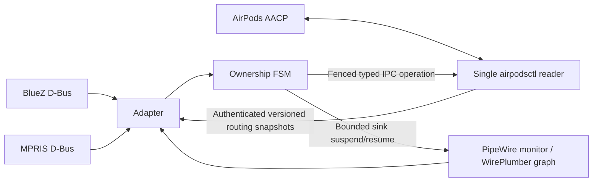

# Architecture

One pair and one desktop user are configured per instance. Pairing and the underlying Bluetooth link are owned by BlueZ, not by this policy.

The FSM keeps arbitration owner, observed AudioSource, source kind, media eligibility, call guards, pending intent, cooldown, connection generation and revision separately. Asynchronous commands carry tokens; superseded replies cannot change the new state or clear a newer command. Transient source NONE is not permission to reclaim.

The local UNIX datagram receiver checks sender UID and controller executable, packet version/size/sequence and connection generation. It does not expose arbitrary raw AACP operations or a network listener. Only the controller reads the Bluetooth control channel.

Policy deadlines bound debounce, intent freshness, idle hysteresis and recovery; there is no periodic playerctl or pw-link loop. Current constants are code-level settings, not auto-tuned performance guarantees. `take-media` performs another fresh source/host exchange inside the controller before sending ownership, so stale UI classification cannot authorize a call takeover.

A successful ownership ACK does not imply an audible output. Audio checks observe source Linux, active transport, a running sink and the final output links. Paused/init links from running playback or EasyEffects output into the matching A2DP sink are recreated once per link serial; microphone/effect internals are untouched. A command ACK never invents an active link state. A failed or delayed stream may receive one sink suspend/resume with cooldown; no profile cycle or Bluetooth reconnect is used. Unsuccessful recovery remains a degraded state instead of an unbounded retry loop.

MPRIS-to-stream matching uses process identity and known application families. This is not proof of foreground user intent. Known players/browsers and explicit media roles have a debounced PipeWire fallback without MPRIS. An existing MPRIS pause suppresses fallback for that application. Untagged unknown applications, continuous silence, ambiguous browser autoplay and simultaneous remote events remain limitations. Calls are tracked by duplex process identity or explicit Communication role; initial sessions are baselines, while a new call can create takeover intent. Sleep clears pre-sleep focus and pending work; resume uses a fresh graph snapshot fenced against concurrent monitor updates.

## Primary interface references

- [PipeWire node properties and media roles](https://docs.pipewire.org/page_man_pipewire-props_7.html).
- [MPRIS playback state and PropertiesChanged](https://specifications.freedesktop.org/mpris/latest/Player_Interface.html).
- [Apple WWDC23 audio integration overview](https://developer.apple.com/videos/play/wwdc2023/10233/): describes platform behavior, not a public Linux-compatible AACP arbiter contract.

## Manual controls and recovery latency

The user-only UNIX control socket checks peer UID and has mode 0600. Status subscribers receive changed snapshots; the optional panel does not add Bluetooth polling. Preferences persist a local pin flag. Startup baselines never imply a fresh manual takeover.

An explicit return re-arms a single user-authorized attempt. Pinning prevents local release while idle; it does not implement Apple's closed firmware ownership lock. Repeated autonomous contention stops at LOCAL_CONTESTED. The fresh controller-side call/unknown guard is preserved.

Known sink errors bypass the natural-transition grace. Recovery repairs newly arriving paused/init edges inside the current event-driven attempt and skips a redundant AACP CLI snapshot. The extra 300ms restore debounce is removed only for a proven local session and typed remote media; new-play debounce is retained.
