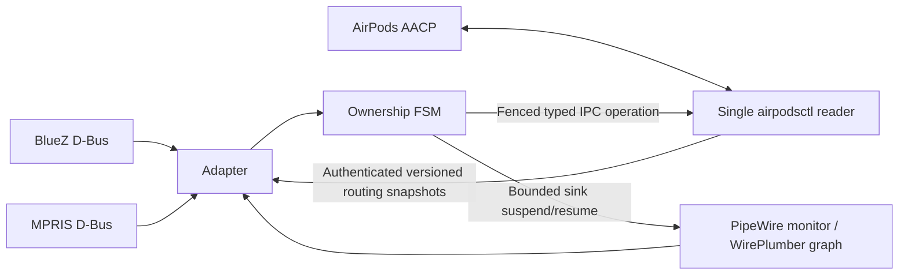

# Architecture

One pair and one desktop user are configured per instance. Pairing and the underlying Bluetooth link are owned by BlueZ, not by this policy.

The FSM keeps arbitration owner, observed AudioSource, source kind, media eligibility, call guards, pending intent, cooldown, connection generation and revision separately. Asynchronous commands carry tokens; superseded replies cannot change the new state or clear a newer command. Transient source NONE is not permission to reclaim.

The local UNIX datagram receiver checks sender UID and controller executable, packet version/size/sequence and connection generation. It does not expose arbitrary raw AACP operations or a network listener. Only the controller reads the Bluetooth control channel.

Policy deadlines bound debounce, intent freshness, idle hysteresis and recovery; there is no periodic playerctl or pw-link loop. Current constants are code-level settings, not auto-tuned performance guarantees. `take-media` performs another fresh source/host exchange inside the controller before sending ownership, so stale UI classification cannot authorize a call takeover.

A successful ownership ACK does not imply an audible output. Audio checks observe source Linux, active transport and a running sink. A failed or delayed stream may receive one sink suspend/resume with cooldown; no profile cycle or Bluetooth reconnect is used. Unsuccessful recovery remains a degraded state instead of an unbounded retry loop.

MPRIS-to-stream matching uses process identity and known application families. This is not proof of foreground user intent. Applications without MPRIS, ambiguous browser autoplay and simultaneous remote events remain important limitations.
